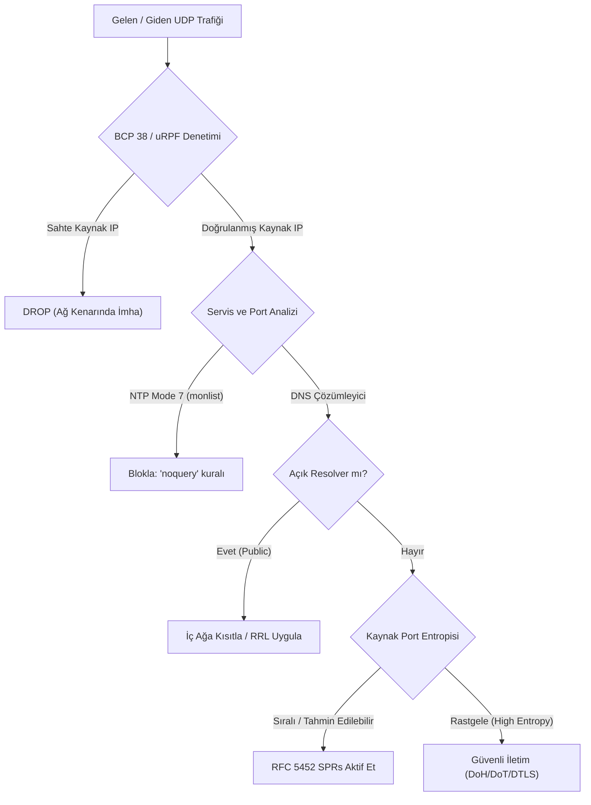

<!--
ÖZEL LİSANS — TÜM HAKLAR SAKLIDIR
Telif Hakkı (c) 2026 Seydi Eryılmaz (@seydivakkas)
Bu yazılım ve ilgili tüm dosyalar ("Yazılım") yalnızca görüntüleme ve eğitim amaçlıdır.
YAZARIN AÇIK YAZILI İZNİ OLMAKSIZIN HİÇBİR KULLANIM HAKKI TANINMAZ.
-->

# Gün 52: UDP (User Datagram Protocol) ve Kullanım Alanları — Usta Dersi

> **Eğitmen Notu:**  
> *"Evlat, TCP güvenilir bir diplomat gibidir; el sıkışır, her kelimeyi onaylatır, sırayı takip eder ve hata varsa baştan anlatır. UDP ise savaş meydanındaki bir topçu eri gibidir; mermiyi namluya sürer ve ateşler. Mermi hedefe vardı mı, havada patladı mı, rüzgâr mı saptırdı umursamaz. İşte bu umursamazlık UDP'ye inanılmaz bir sürat kazandırır; ancak aynı umursamazlık, siber korsanların elinde tüm internet omurgasını çökertebilecek devasa bir amplifikasyon silahına dönüşür. Bugün bu protokolün kalbine inecek, sadece 8 baytlık başlığın arkasındaki dehşeti ve onu nasıl savunacağını öğreneceksin."*

---

## 1. Giriş ve Temel Felsefe: TCP Varken Neden UDP?

Ağ mühendisliğinde ve siber güvenlikte en temel yasalardan biri şudur: **"Her güvenilirlik katmanı, gecikme (latency) ve başlık yükü (overhead) faturası keser."**

TCP, güvenilirlik sağlamak için:
1. 3 aşamalı el sıkışma yapar (1 RTT gecikme).
2. En az 20 baytlık devasa bir başlık taşır.
3. Alınan her bayt için ACK bekler ve kayan pencere yönetir.
4. Paket kaybolursa hattı bloke eder (Head-of-Line Blocking).

Fakat canlı video yayını (RTP/SRTP), sesli görüşme (VoIP), online oyunlar veya anlık sorgular (DNS, NTP) için kaybolan bir paketi 200 ms sonra yeniden göndermenin hiçbir kıymeti yoktur. Görüntüde bir piksel bozulabilir veya bir ses hecesi yutulabilir; ancak yayın donmamalıdır.

İşte **RFC 768 (Ağustos 1980)** ile standartlaştırılan **UDP (User Datagram Protocol)** bu felsefeyle doğmuştur:
- **Bağlantısızdır (Connectionless):** Önceden el sıkışma yapılmaz.
- **Durumsuzdur (Stateless):** Çekirdek (kernel) sokette TCP gibi TCB (Transmission Control Block) veya durum makinesi (SYN-SENT, ESTABLISHED) tutmaz.
- **Datagram Tabanlıdır (Message-Oriented):** TCP bir bayt akışı (stream) iken, UDP her `send()` çağrısını bağımsız bir sınırla (boundary) paketler.

---

## 2. RFC 768 Başlık Mimarisi ve Sahte Başlık (Pseudo-Header)

UDP başlığı internet protokolleri tarihindeki en sade ve zarif başlıklardan biridir. Toplam **8 bayt (64 bit)** uzunluğundadır:

```text
 0                   1                   2                   3
 0 1 2 3 4 5 6 7 8 9 0 1 2 3 4 5 6 7 8 9 0 1 2 3 4 5 6 7 8 9 0 1
+-+-+-+-+-+-+-+-+-+-+-+-+-+-+-+-+-+-+-+-+-+-+-+-+-+-+-+-+-+-+-+-+
|          Source Port          |       Destination Port        |
+-+-+-+-+-+-+-+-+-+-+-+-+-+-+-+-+-+-+-+-+-+-+-+-+-+-+-+-+-+-+-+-+
|            Length             |           Checksum            |
+-+-+-+-+-+-+-+-+-+-+-+-+-+-+-+-+-+-+-+-+-+-+-+-+-+-+-+-+-+-+-+-+
```

### Alanların Teknik Analizi:
1. **Source Port (16-bit):** Gönderen uygulamanın port numarasıdır (0-65535). İstemci yanıt beklemiyorsa 0 olabilir.
2. **Destination Port (16-bit):** Hedef servisin portudur (Örn. DNS: 53, NTP: 123, SNMP: 161).
3. **Length (16-bit):** UDP başlığı (8 bayt) ve veri yükünün toplam bayt sayısıdır. Minimum değer **8**'dir (yüksüz paket). Maksimum teorik değer 65,535 bayttır (ancak MTU 1500 bayt olduğu için parçalanmayı önlemek adına genelde daha küçük tutulur).
4. **Checksum (16-bit):** Hata denetimi için birin tümleyeni (one's complement) toplamıdır.

### Kritik Güvenlik ve Standart İstisnası: Checksum = 0x0000
- **IPv4 Kuralı:** IPv4'te UDP checksum kullanımı **isteğe bağlıdır (optional)**. Eğer gönderici checksum hesaplamazsa alana `0x0000` yazar. Alıcı `0x0000` gördüğünde paket bütünlüğünü kontrol etmeden doğrudan kabul eder. (Eğer hesaplanan checksum tesadüfen 0 çıkarsa, `0xFFFF` olarak yazılır).
- **IPv6 Kuralı (RFC 8200):** IPv6 başlığında IP checksum alanı kaldırıldığı için, UDP checksum kullanımı **ZORUNLUDUR**. IPv6'da gelen `0x0000` checksum'lı UDP paketleri çekirdek tarafından sessizce düşürülür (DROP).

### Sahte Başlık (Pseudo-Header) Mekanizması:
UDP başlığı kendi içinde IP adreslerini barındırmaz. Ancak bir paketin yanlış bir IP'ye gitmediğinden emin olmak için sağlama toplamı hesaplanırken IP katmanından 12 baytlık sanal bir başlık ödünç alınır:
- Kaynak IP (4 Bayt)
- Hedef IP (4 Bayt)
- Sıfır (1 Bayt, `0x00`)
- Protokol Numarası (1 Bayt, UDP = `17` / `0x11`)
- UDP Uzunluğu (2 Bayt)

Bu 12 bayt, 8 baytlık UDP başlığı ve veri yükü ile uç uca eklenerek 16-bitlik kelimeler halinde toplanır.

---

## 3. UDP'nin Yaşamsal Kullanım Alanları ve Protokol Analizi

UDP'yi yalnızca "hızlı veri transferi" olarak görmek sığ bir yaklaşımdır. İnternetin temel altyapısı UDP üzerinde yükselir:

| Protokol | Port | Kullanım Amacı | Neden UDP? |
|---|---|---|---|
| **DNS** | 53 | İsim çözümleme | Tek bir sorgu ve tek bir yanıt için 3'lü el sıkışma yapmak gecikmeyi 3 katına çıkarır. |
| **DHCP** | 67 / 68 | Otomatik IP yapılandırması | İstemcinin henüz IP'si yoktur; IP olmadan TCP bağlantısı kurulamaz. Broadcast UDP şarttır. |
| **NTP** | 123 | Saat senkronizasyonu | Gecikme sürelerindeki dalgalanmaları (jitter) en aza indirmek ve mikrosaniye hassasiyetine ulaşmak için. |
| **SNMP** | 161 / 162 | Ağ cihazı yönetimi ve telemetri | Çöken bir anahtar veya yönlendirici TCP kuracak durumda olmayabilir; hafif telemetri şarttır. |
| **Syslog** | 514 | Merkezi olay günlükleri | Log sunucusu kapalı olsa bile çalışan uygulamanın TCP beklemesi yüzünden kilitlenmesini önler. |
| **QUIC / HTTP/3** | 443 | Modern web protokolü | TCP'nin Head-of-Line Blocking ve el sıkışma hantallığını UDP üzerinde TLS 1.3 ile çözmüştür. |

---

## 4. Tehdit Modeli: Siber Korsanların UDP İstismarları

UDP'nin bağlantısız ve durumsuz yapısı, saldırganlar için benzersiz fırsatlar sunar:

### A. IP Sahteciliği (IP Spoofing)
TCP'de kaynak IP'yi sahtelerseniz, hedef sunucunun gönderdiği SYN-ACK sahtelenen kurbana gider. Siz ACK iletemeyeceğiniz için bağlantı kurulamaz.  
**UDP'de ise el sıkışma yoktur.** Saldırgan, paketin kaynak IP hanesine kurbanın IP adresini yazar ve hedef sunucuya fırlatır. Sunucu yanıtı doğrudan kurbana gönderir!

### B. Yansıtma ve Amplifikasyon DDoS (Reflection & Amplification)
Saldırgan sahte kaynak IP ile savunmasız bir servise 50 baytlık küçük bir istek atar. Servis kurbana 3000 baytlık devasa bir yanıt yansıtır.
- **Bant Genişliği Amplifikasyon Faktörü (BAF):**  
  $$\text{BAF} = \frac{\text{Yanıt Boyutu (Bayt)}}{\text{İstek Boyutu (Bayt)}}$$
- **NTP monlist Vakası:** Eski NTP sunucularına gönderilen 8 baytlık `monlist` isteği, sunucuya en son bağlanan 600 istemcinin IP listesini döner. Yanıt boyutu 4000 bayttan fazladır (**BAF > 500x**).
- **DNS ANY Vakası:** DNS ANY sorgusu ile EDNS0 genişletmesi birleştiğinde 50 baytlık istek 3000-4000 baytlık DNSSEC anahtarları ve kayıtlarıyla döner (**BAF ~50x**).
- **Memcached Faciası (2018):** Varsayılan olarak UDP portu 11211 açık bırakılan memcached sunucuları 15 baytlık isteğe megabaytlarca veri dönmüştür (**BAF ~50,000x**). GitHub'a tarihin en büyük saldırılarından biri (1.35 Tbps) bu şekilde yapılmıştır.

### C. Kaminsky DNS Cache Poisoning (Önbellek Zehirleme)
2008 yılında Dan Kaminsky tarafından keşfedilen bu saldırıda, saldırgan bir DNS sunucusunun kaynak portu sabitse (örn. hep port 53'ten soruyorsa), yalnızca 16-bitlik Transaction ID'yi (65,536 olasılık) tahmin ederek sahte IP adresini DNS önbelleğine enjekte edebilmiştir.

---

## 5. Savunma Mimarisi ve Sıkılaştırma Stratejileri

Bir siber güvenlik mühendisi UDP tehditlerine karşı şu katmanlı savunma hattını kurmalıdır:



1. **BCP 38 / RFC 2827 (Ingress Filtering):** Servis sağlayıcılar ve kurumlar, kendi ağlarından çıkış yapan paketlerin kaynak IP'sinin kendi tahsisli bloklarında olup olmadığını denetlemelidir (uRPF). Sahte paketler daha ağdan çıkmadan düşürülürse amplifikasyon yapılamaz.
2. **Response Rate Limiting (RRL):** DNS sunucuları aynı istemci IP'sine saniyede döneceği yanıt sayısını kısıtlar. Eşik aşılırsa paket `TC=1 (Truncated)` bayrağıyla dönülür; bu da meşru istemciyi TCP el sıkışmasına zorlayarak sahte saldırıyı bertaraf eder.
3. **Amplifikasyon Özelliklerini Kapatma:** NTP'de `ntp.conf` içerisine `restrict default kod nomodify notrap nopeer noquery` yazılmalıdır.
4. **Kaynak Port Rastgeleleştirmesi (RFC 5452 - SPRs):** DNS istemcileri 1024-65535 arasındaki ephemeral portları kriptografik olarak rastgele seçmelidir. Böylece saldırganın tahmin uzayı 16 bitlik TxID'den **32 bite (4 milyar kombinasyon)** çıkar.
5. **Üst Katman Kriptografisi:** DNS trafiği DoH (DNS over HTTPS) veya DoT (DNS over TLS) ile, VoIP trafiği SRTP ile, genel UDP ise DTLS (Datagram TLS) ile şifrelenmeli ve kimlik doğrulamasına bağlanmalıdır.

---

## 6. Usta Tavsiyeleri ve Altın Kurallar

1. **"Gereksiz UDP Portu Bırakma":** Bir sunucuda TFTP (69), Chargen (19), Echo (7) veya açık SNMP (161) çalışıyorsa derhal kapat. Kapatmadığın her UDP portu bir gün bir DDoS saldırısında sana karşı yansıtıcı olarak kullanılır.
2. **"UDP Paket Kaybı Normaldir, Fırtınası Anormaldir":** UDP paketlerinin bir kısmı ağ sıkışıklığında düşebilir. Ancak saniyede binlerce UDP paketi geliyorsa ve hedef portlar kapalıysa sistem ICMP Type 3 Code 3 (Port Unreachable) fırtınasıyla CPU'sunu tüketiyor demektir. Güvenlik duvarında UDP rate-limiting kuralı şarttır.
3. **"Doğrulama Yapmayan Protokol Kör Eder":** Uygulama katmanında oturum ve sıra denetimi yapmıyorsan UDP üzerinden gelen veriye asla güvenme.
