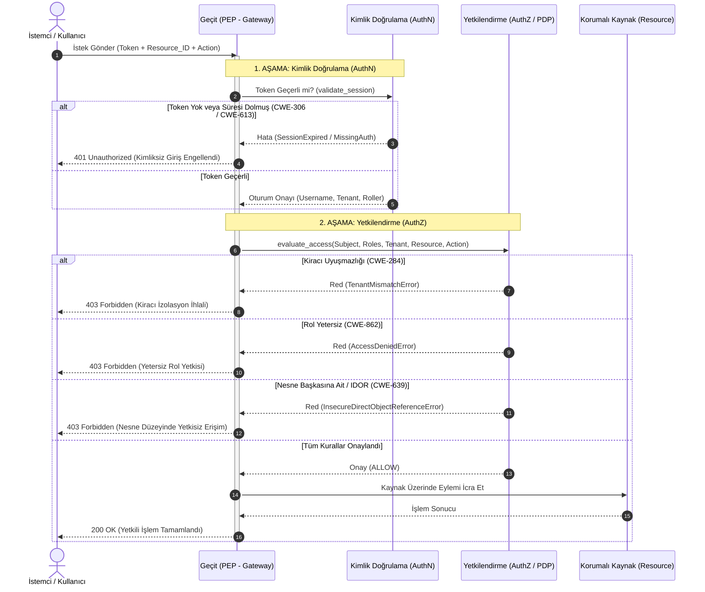

# Hafta 17 / Gün 113: Kimlik Doğrulama (AuthN) ile Yetkilendirme (AuthZ) Arasındaki Katı Sınır

**Eğitmen / Usta:** Seydi Eryılmaz (@seydivakkas)  
**Telif Hakkı:** © 2026 Seydi Eryılmaz — Tüm Hakları Saklıdır.  
**Kapsam:** Kimlik ve Erişim Yönetimi (Identity & Access Management - IAM) Temelleri  
**Standartlar:** NIST SP 800-63B, OWASP Top 10 (A01:2021, A07:2021), RFC 2104, CWE-287, CWE-285, CWE-639  

---

## 1. Ustanın Giriş Dersi: "Sen Kimsin?" ile "Ne Yapabilirsin?" Ayrımı

Evlat, siber güvenliğin en ölümcül, en sık tekrarlanan ve en çok sistem çökerten yanılgılarından birine adım atıyoruz. Yazılım dünyasında tecrübesiz mühendislerin düştüğü klasik tuzak şudur: 
> *"Kullanıcı giriş yaptı (Logged In), parolası doğru, demek ki sistemimize dahil biridir; o halde istediği veriyi getirebiliriz."*

Bu düşünce, binlerce şirketin müşteri verilerini sızdıran, milyonlarca liralık tazminatlara yol açan devasa bir mimari körlüktür. Kimlik ve Erişim Yönetimi (IAM) disiplininde iki bağımsız, asla birbirinin yerine ikame edilemeyecek kutsal sütun vardır:

1. **Kimlik Doğrulama (Authentication — AuthN):**
   - **Temel Soru:** *"Sen kimsin?" (Who are you?)*
   - **Amaç:** Dış dünyadan gelen bir öznenin (subject/principal; insan, servis hesabı, API istemcisi) iddia ettiği kimliğin doğruluğunu kanıtlaması sürecidir.
   - **Mekanizmalar:** Parolalar (Salted PBKDF2/Argon2 özetleri), kriptografik asimetrik imza anahtarları, çok faktörlü doğrulama (MFA - TOTP, FIDO2/WebAuthn), biyometrik doğrulamalar.
   - **Çıktı:** Güvenli, sahteciliğe dirençli bir oturum kimliği veya kimlik belirteci (Session Token / Identity Assertion).

2. **Yetkilendirme (Authorization — AuthZ):**
   - **Temel Soru:** *"Sen ne yapabilirsin?" (What are you allowed to do?)*
   - **Amaç:** Kimliği şüpheye yer bırakmayacak biçimde doğrulanmış olan öznenin, hedef bir kaynak (resource) üzerinde belirli bir eylemi (action/operation) gerçekleştirme meşruiyetine sahip olup olmadığını denetlemektir.
   - **Mekanizmalar:** Rol Tabanlı Erişim Kontrolü (RBAC), Öznitelik Tabanlı Erişim Kontrolü (ABAC), Politika Karar Noktaları (PDP - Policy Decision Point), Açık Red (Default Deny / Whitelist) kuralları, Nesne Düzeyinde İzin Doğrulaması (Object-Level Authorization).
   - **Çıktı:** İkili (Binary) Karar: `ALLOW` (İzin Verildi) veya `DENY` (Reddedildi).

> [!IMPORTANT]
> Unutma evlat: Kimlik doğrulama, yetkilendirmenin yalnızca **ön koşuludur**; yetkilendirmenin kendisi değildir! Kimliği %100 doğrulanmış bir genel müdür bile, insan kaynakları veritabanında maaş tablosunu silme yetkisine sahip olmayabilir.

---

## 2. Derinlemesine Mimari: İki Kademeli Geçit (Dual-Gate PEP)

Bir kurumsal güvenlik ağında hiçbir iş yükü veya iş mantığı fonksiyonu, doğrudan istemci isteğiyle temas edemez. Arada mutlaka **Politika Uygulama Noktası (PEP — Policy Enforcement Point)** durmalıdır.

Aşağıdaki akış şeması, günümüzde Zero Trust (Sıfır Güven) mimarilerinin kalbini oluşturan iki kademeli geçit mekanizmasını gösterir:

---

## 3. Kodlama Standartları ve Kaçınılması Gereken Zafiyetler

Bugün geliştirdiğimiz `authn_authz_engine.py` motorunda ele aldığımız ve her savunmacı mühendisin ezbere bilmesi gereken temel güvenlik açıkları:

### A. CWE-208: Observable Timing Discrepancy (Zamanlama Yan Kanalı)
Standart string karşılaştırması (`hash1 == hash2`) ilk eşleşmeyen karakterde döngüyü kırar. Saldırgan mikrosaniye düzeyinde ağ gecikmesini ölçerek parolanın veya özetin karakterlerini tek tek tahmin edebilir.
- **Çözüm:** Python'ın `secrets.compare_digest()` veya `hmac.compare_digest()` fonksiyonları kullanılır. Bu fonksiyonlar özetin tamamını sabit sürede (constant-time) karşılaştırarak zaman sızıntısını ortadan kaldırır.

### B. CWE-307: Kaba Kuvvet (Brute-Force) ve Hesap Kilitleme
Parola doğrulama sonsuz denemeye açık bırakılırsa, saldırgan saniyede binlerce parola deneyebilir.
- **Çözüm:** 3 ila 5 ardışık başarısız denemeden sonra hesap geçici olarak (örneğin 15 dakika) dondurulur (`is_locked = True`, `lock_until = now + 900s`).

### C. CWE-384: Oturum Sabitleme (Session Fixation)
Saldırgan kurbana önceden bildiği bir oturum kimliğini enjekte eder ve kurban giriş yaptığında aynı belirteçle yetki kazanır.
- **Çözüm:** Başarılı her kimlik doğrulamada kullanıcının önceki tüm oturumları iptal edilir ve sıfırdan kriptografik rastgele 32-baytlık belirteç üretilir.

### D. CWE-639 / CWE-862: IDOR (Insecure Direct Object Reference)
Uygulama kullanıcının `READ_DOCUMENT` yetkisine sahip olduğunu doğrular, ancak istenen belgenin (`doc_id=101`) o kullanıcıya mı yoksa başka bir müşteriye mi ait olduğunu denetlemez.
- **Çözüm:** Nesne düzeyinde erişim denetimi (Object-Level Access Control). Yetki olsa dahi nesnenin `owner_username` alanı kontrol edilir; kullanıcı yönetici (admin) değilse erişim derhal `InsecureDirectObjectReferenceError` ile engellenir.

### E. CWE-284: Çok Kiracılı (Multi-Tenant) İzolasyon
SaaS platformlarında şirket A'nın kullanıcısı şirket B'nin kayıtlarına asla erişememelidir.
- **Çözüm:** Her kaynağa ve her oturuma `tenant_id` damgalanır. `tenant_user != tenant_resource` durumu istisnasız `TenantMismatchError` üretir.

---

## 4. Ustanın Öğüdü: Sahada Karşılaşacağın Zorluklar

> [!TIP]
> Bir gün banka veya telekom altyapısında çalışırken önünüze şu soru gelecek: *"Her API çağrısında hem veritabanından kullanıcıyı hem de yetkiyi sorgularsak sistem yavaşlar mı?"*
> 
> Çırak burada hemen güvenlikten ödün verir; oturum kontrolünü kaldırır veya yetkiyi istemcinin gönderdiği JWT içine güvenmeden koyar. Usta ise şunu yapar:
> - Kimlik doğrulama oturumunu (AuthN) dağıtık yüksek hızlı önbelleğe (Redis, in-memory cache) koyar ve kriptografik özetle doğrular.
> - Yetki matrisini (AuthZ) bellek içi Politika Karar Motorunda (OPA / Rego / in-memory matrix) mikrosaniyeler mertebesinde işletir.
> 
> Asla ama asla performans gerekçesiyle AuthZ denetimini atlama! Güvenlikten tasarruf edilen milisaniyeler, veri sızıntısıyla sonuçlandığında yıllarca sürecek itibar kaybına dönüşür.
