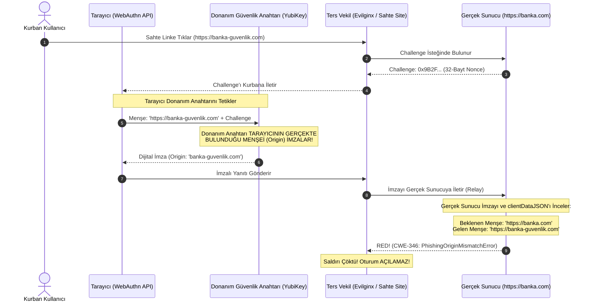

# Hafta 17 / Gün 114: Çok Faktörlü Kimlik Doğrulama (MFA) Yöntemleri ve Oltalama (Phishing) Direnci

**Eğitmen / Usta:** Seydi Eryılmaz (@seydivakkas)  
**Telif Hakkı:** © 2026 Seydi Eryılmaz — Tüm Hakları Saklıdır.  
**Kapsam:** Kimlik ve Erişim Yönetimi (IAM) / MFA Standartları ve Saldırı Vektörleri  
**Standartlar:** RFC 6238, W3C WebAuthn Level 2/3, FIDO2, NIST SP 800-63B, OWASP Top 10 (A07:2021)  

---

## 1. Ustanın Giriş Dersi: "İki Faktörlü Doğrulama" Efsanesi ve Acı Gerçekler

Evlat, güvenlik dünyasında herkesin dilinde bir tekerleme vardır: *"Parolanızı güçlü yapın ve iki faktörlü doğrulamayı (2FA/MFA) açın, güvendesiniz!"*

Sana ustan olarak açık konuşayım: Bu ifade 2012 yılında geçerliydi, ancak bugün yarı yarıya bir yalandır. Neden mi? Çünkü günümüz siber saldırganları artık kaba kuvvetle parola tahmin etmeye çalışmıyor. Modern saldırganlar **Ters Vekil (Reverse Proxy / AiTM — Adversary-in-the-Middle)** araçlarını (Evilginx2, Modlishka, Muraena) kullanıyor.

Bir saldırgan, senin kurbanına sahte bir Microsoft 365, Google veya banka login sayfası sunduğunda:
- Kurban kullanıcı adını ve parolasını sahte sayfaya yazar.
- Ters vekil bunu anında gerçek Microsoft/Banka sunucusuna iletir.
- Gerçek sunucu *"Telefonuna 6 haneli SMS veya TOTP kodunu gönderdim, gir"* der.
- Kurban telefonundaki Google Authenticator'ı açar, `839 102` kodunu sahte sayfaya yazar.
- Ters vekil bu kodu mikrosaniyeler içinde gerçek sunucuya basar.
- Gerçek sunucu kimlik doğrulamasını onaylar ve **Oturum Çerezini (Session Cookie / Bearer Token)** üretir.
- Ters vekil oturum çerezini yakalar ve kurbanın hesabına saldırgan oturur!

Kurban iki faktör de kullandı: Parolayı da girdi, OTP kodunu da girdi. Peki ne oldu? Hesap yine hacklendi!

İşte bu yüzden NIST (National Institute of Standards and Technology), **NIST SP 800-63B** yönergesinde kimlik doğrulamayı ikiye ayırmıştır:
1. **Phishing-Resistant Olmayan MFA (Zayıf/Orta):** SMS OTP, E-posta OTP, RFC 6238 TOTP, Standart Mobil Push Bildirimleri.
2. **Phishing-Resistant (Oltalama Dirençli) MFA (Güçlü - AAL3):** FIDO2 / WebAuthn standardı (YubiKey, Passkeys, Windows Hello, Apple TouchID/FaceID).

---

## 2. Derinlemesine Mimari: Kriptografik Menşe Bağlama (Cryptographic Origin Binding)

FIDO2 ve WebAuthn'u diğer tüm MFA yöntemlerinden ayıran ve onu matematiksel olarak oltalama saldırılarına karşı **bağışık** kılan sihirli teknoloji **Kriptografik Menşe Bağlamadır (Cryptographic Origin Binding)**.

Aşağıdaki şemayı dikkatle incele evlat:

Gördün mü evlat? Kurban ne kadar dikkatsiz olursa olsun, sahte siteye ne kadar inanırsa inansın; **Donanım Anahtarı kurbana değil, tarayıcının TLS bağlantısındaki gerçek alan adına bakar!** Tarayıcı donanım anahtarına sahte sitenin adını (`banka-guvenlik.com`) fısıldar. Donanım anahtarı bu sahte adı imzalar. Gerçek sunucu imzanın kendi alan adı için atılmadığını görünce isteği kapıdan kovar!

---

## 3. MFA Yöntemlerinin Karşılaştırmalı Risk Analizi

| Yöntem | Faktör Türü | AiTM / Ters Vekil Direnci | SIM Swap Riski | Yorgunluk (Fatigue) Riski | NIST Güvence Seviyesi |
|---|---|---|---|---|---|
| **SMS OTP** | Sahip Olunan (Taşıyıcı) | **SIFIR (0/10)** | **Çok Yüksek** (SS7 / Bayi aldatma) | Düşük | NIST Kısıtlı / Güvensiz |
| **E-Posta OTP** | Sahip Olunan (Hesap) | **SIFIR (0/10)** | Orta (E-posta çalınırsa hepsi gider) | Düşük | NIST Kısıtlı |
| **RFC 6238 TOTP** | Sahip Olunan (Uygulama) | **SIFIR (0/10)** (Evilginx çalar) | Yok (Cihazda lokal anahtar) | Düşük | NIST AAL2 (Phishing hariç güçlü) |
| **Mobil Push Onayı** | Sahip Olunan (Push Bildirimi) | **Çok Düşük (2/10)** | Yok | **Çok Yüksek** (MFA Spamming / Bıkkınlık) | NIST AAL2 (Sayı eşleme şart) |
| **FIDO2 / WebAuthn** | Sahip Olunan + Biyometrik | **TAM DİRENÇ (10/10)** (Origin Binding) | **SIFIR** | **SIFIR** (Kullanıcı niyeti ve menşe şart) | NIST AAL3 (En Üst Düzey) |

---

## 4. Kodlama Standartları ve Güvenlik Mekanizmaları

Bugün geliştirdiğimiz `mfa_phishing_resistant_engine.py` motorunda inşa ettiğimiz savunma katmanları:

### A. RFC 6238 TOTP Replay Koruması (CWE-294)
TOTP kodları 30 saniye boyunca geçerlidir. Bir kullanıcı veya saldırgan aynı 30 saniyelik zaman adımı içinde o kodu bir kez kullandıktan sonra sistem `last_used_step` değerini günceller. Aynı adımda gelen sonraki tüm istekler `TOTPReplayError` ile reddedilir.

### B. FIDO2 Tek Kullanımlık Meydan Okuma (Challenge Nonce — CWE-294)
Sunucu her oturum açma denemesinde 32-baytlık kriptografik rastgele bir `challenge` üretir ve bunu 120 saniyelik bir süreyle önbelleğe alır. Bu meydan okuma tek kullanımlıktır (`is_used = True`). Eski bir cevabı tekrar sunan saldırgan doğrudan engellenir.

### C. FIDO2 Klonlama Tespiti (Authenticator SignCount — CWE-347)
Her donanım anahtarı içinde donanımsal, geriye sarılamaz bir sayaç (`sign_count`) tutar. Anahtara her dokunulduğunda sayaç bir artar. Sunucu, gelen yanıttaki sayacın kayıtlı sayaçtan büyük olduğunu (`incoming_sign_count > stored_sign_count`) denetler. Eğer sayaç geriye gitmişse veya eşit kalmışsa, anahtarın klonlandığı anlaşılır (`AuthenticatorCloneDetectedError`).

---

## 5. Ustanın Çırağa Öğüdü

> [!IMPORTANT]
> Çırağım, bir kurumda yönetici veya siber mimar olduğunda personeline "Oltalama e-postalarına tıklamayın" diye yüzlerce saat eğitim verebilirsin. Ama unutma: İnsan yorulur, insan hata yapar, insan aceleyle o linke tıklar.
> 
> Güvenliği insanın dikkatine emanet edemezsin. Güvenliği **matematiğe** emanet edeceksin! Kurumundaki tüm kritik sistemlere (VPN, Admin Panelleri, SSH erişimleri, Cloud Root hesapları) FIDO2 / WebAuthn donanım anahtarlarını (Passkeys / YubiKey) zorunlu kılacaksın. Personel sahte siteye tıklasa bile, kriptografik menşe bağlama saldırganı kapıda felç edecektir.
