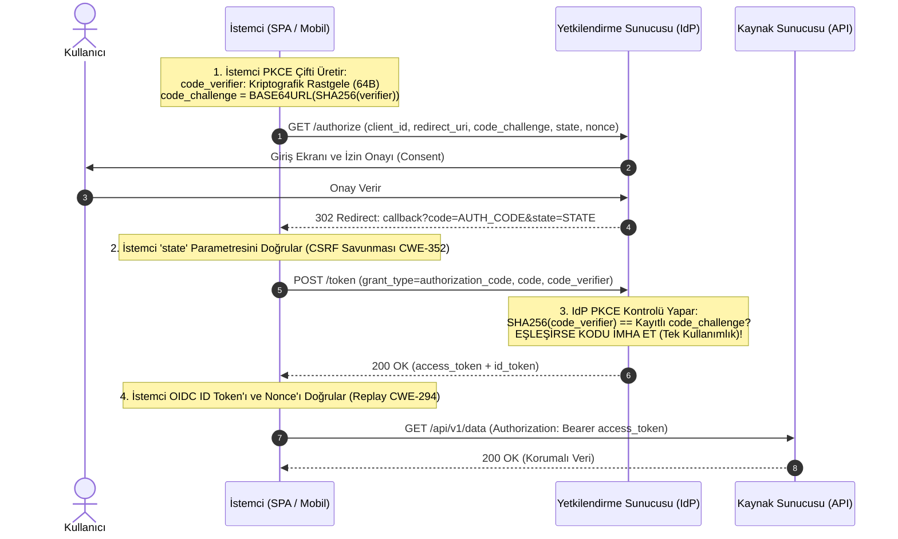

# Hafta 17 / Gün 115: OAuth 2.0 ve OpenID Connect (OIDC) — Yetki Devri ile Kimliğin Dansı

**Eğitmen / Usta:** Seydi Eryılmaz (@seydivakkas)  
**Telif Hakkı:** © 2026 Seydi Eryılmaz — Tüm Hakları Saklıdır.  
**Kapsam:** Kimlik ve Erişim Yönetimi (IAM) / Dağıtık Protokoller  
**Standartlar:** RFC 6749, RFC 7636 (PKCE), OIDC Core 1.0, RFC 7519 (JWT), OWASP Top 10 (A01:2021, A07:2021)  

---

## 1. Ustanın Giriş Dersi: "Anahtarı Vermek" ile "Otele Giriş Kartı Vermek"

Evlat, modern internet mimarisinde en çok kafası karışan konulardan biri OAuth 2.0 ile OpenID Connect (OIDC) arasındaki farktır. Çoğu yazılımcı *"Google ile Giriş Yap"* düğmesini gördüğünde bunun OAuth olduğunu zanneder. Hayır! O bir OIDC akışıdır.

Aralarındaki farkı sana hayatın içinden bir analojiyle anlatayım:
- **OAuth 2.0 (Yetki Devri — Delegated Authorization):** Bir otelde valeye arabanın anahtarını vermek gibidir. Vale senin kim olduğunu (adını, TC kimlik numaranı) bilmek zorunda değildir. Anahtar ona sadece arabayı park etme *yetkisi* verir. İşte `access_token` tam olarak budur. API'ye sunulur ve belirli bir eylem için kapıyı açar.
- **OpenID Connect (Kimlik İspatı — Federated Authentication):** Otelin resepsiyonuna kimliğini gösterip üzerine adın, soyadın ve oda numaran yazılı fotoğraflı bir otel kartı almaktır. Kartın üzerinde senin kimliğin (`id_token`) yazar. OIDC, OAuth 2.0'ın üzerine inşa edilmiş bir kimlik doğrulama katmanıdır.

> [!IMPORTANT]
> Unutma evlat: **OAuth 2.0 bir kimlik doğrulama protokolü DEĞİLDİR!** OAuth 2.0 bir yetkilendirme (authorization) çerçevesidir. Kimlik doğrulamak istiyorsan mutlaka OpenID Connect (OIDC) kullanacaksın. `access_token` ile kimlik doğrulamaya çalışmak, ehliyeti pasaport sanıp sınır kapısından geçmeye çalışmak gibidir!

---

## 2. Derinlemesine Mimari: RFC 7636 PKCE (Proof Key for Code Exchange)

Geleneksel Authorization Code akışında istemci bir `authorization_code` alır ve bunu sunucuda `client_secret` ile takas eder. Ancak mobil uygulamalar veya Single Page Application (SPA / React / Vue) gibi **Genel İstemciler (Public Clients)** kaynak kodlarında veya cihaz hafızasında asla bir `client_secret` gizleyemezler! Tersine mühendislikle o secret anında çalınır.

Peki gizli anahtarı olmayan bir istemciyi kod çalma saldırılarından (Authorization Code Interception — CWE-287) nasıl koruruz? Cevap: **PKCE (Proof Key for Code Exchange — RFC 7636)**.

Aşağıdaki şemayı dikkatle incele:

### PKCE Saldırganı Nasıl Felç Eder?
Bir kötü amaçlı yazılım (malware) veya cihazdaki sahte bir uygulama işletim sisteminin URI şemasını dinleyerek `AUTH_CODE` değerini çalsa dahi; `/token` uç noktasına gittiğinde sunucu ondan `code_verifier` talep edecektir. Saldırganın elinde sadece hash (`code_challenge`) vardır; kriptografik özet fonksiyonlarının tek yönlü (one-way) olması sebebiyle saldırgan `code_verifier`'ı matematiksel olarak üretemez ve belirteç takası **CWE-287 PKCEVerificationFailedError** ile anında çöker!

---

## 3. Protokol Düzeyinde Kaçınılması Gereken Zafiyetler

Bugün geliştirdiğimiz `oauth2_oidc_engine.py` motorunda inşa ettiğimiz ve her siber güvenlik mühendisinin denetlemesi gereken kritik noktalar:

### A. CWE-601: Açık Yönlendirici (Open Redirector)
Saldırgan `/authorize?redirect_uri=https://attacker.com` gönderdiğinde, sunucu kullanıcıyı oraya yönlendirirse kullanıcının yetkilendirme kodu doğrudan saldırganın sunucusuna düşer.
- **Savunma:** Sunucu `redirect_uri` parametresini mutlak bir **beyaz liste (strict whitelist)** ile eşleştirmelidir. Joker karakter (`*`) veya regex esnekliklerine asla izin verilmez!

### B. CWE-352: Siteler Arası İstek Sahteciliği (CSRF)
Saldırgan kendi yetkilendirme kodunu kurbana zorla işletebilir (Login CSRF).
- **Savunma:** İstemci yetkilendirme isteğinde yüksek entropili rastgele bir `state` üretmeli ve oturumunda saklamalıdır. Callback geldiğinde gelen state ile saklanan state `secrets.compare_digest` ile doğrulanmalıdır.

### C. CWE-294: Yetkilendirme Kodu ve Nonce Tekrarı (Replay)
Kullanılmış bir `authorization_code` tekrar sunulduğunda sunucu ikinci kez token üretirse saldırgan oturumu çalar.
- **Savunma:** Her kod tek kullanımlıktır (`is_used = True`) ve ömrü 60 saniyeden uzun olamaz. ID Token içinde ise istemcinin gönderdiği `nonce` değeri bulunmalı ve istemci tarafından teyit edilmelidir.

### D. CWE-285: Kapsam İhlali (Insufficient Scope)
İstemci sadece `read:profile` izni almışken gidip `read:reports` veya `write:admin` API'sini çağıramaz.
- **Savunma:** Kaynak Sunucusu (Resource Server), gelen her Bearer belirtecinin içindeki `scopes` kümesini API'nin asgari gereksinimiyle karşılaştırmalıdır.

---

## 4. Ustanın Çırağa Öğüdü

> [!TIP]
> Çırağım, sahada sana bir gün "Biz sadece web uygulamasıyız, gizli istemciyiz (confidential), PKCE kullanmamıza gerek yok" diyecekler. Onlara şunu söyle:
> **OAuth 2.1 Güvenlik Standardı, ayrım gözetmeksizin TÜM istemciler (hem confidential hem public) için PKCE'yi ZORUNLU kılmıştır!**
> 
> Güvenlikte tembellik olmaz. Bir protokolün en sıkı, en katı standardı neyse onu uygulayacaksın. PKCE eklemenin maliyeti birkaç satır koddur; eklememenin maliyeti ise tüm kullanıcı tabanının ele geçirilmesidir.
