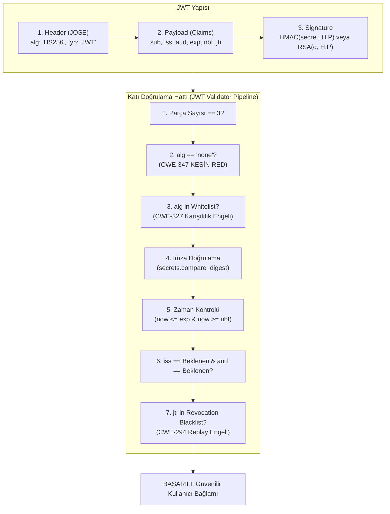

# Hafta 17 / Gün 116: JSON Web Token (JWT) Yapısı ve Güvenli Doğrulama

**Eğitmen / Usta:** Seydi Eryılmaz (@seydivakkas)  
**Telif Hakkı:** © 2026 Seydi Eryılmaz — Tüm Hakları Saklıdır.  
**Kapsam:** Kimlik ve Erişim Yönetimi (IAM) / Belirteç Güvenliği  
**Standartlar:** RFC 7519 (JWT), RFC 7515 (JWS), RFC 7518 (JWA), OWASP Top 10 (A01:2021, A07:2021)  

---

## 1. Ustanın Giriş Dersi: "Şeffaf Zarfın Üzerindeki Mühür"

Evlat, modern web ve mikroservis mimarilerinde en çok istismar edilen, en çok yanlış anlaşılan teknoloji JSON Web Token'dır (JWT). Yazılımcıların %90'ı JWT'yi görünce şöyle der: 
> *"Aaa, bu karmaşık uzun metin şifreli (encrypted), demek ki içindeki veriyi kimse göremez!"*

Bu, bir güvenlik mühendisinin duyabileceği en dehşet verici yanılgıdır!

Sana ustan olarak gerçeği söyleyeyim: **Standart bir JWT şifrelenmiş (encrypted) DEĞİLDİR! Sadece ve sadece imzalanmıştır (signed).**

JWT'yi şeffaf bir zarf gibi düşün: İçindeki mektubu (Payload) yoldan geçen herkes, tarayıcıyı açan her kullanıcı `base64.b64decode()` yaparak saniyeler içinde okuyabilir. Zarfa güç veren şey gizliliği değil; üzerindeki **kriptografik mühürdür (Signature)**. Eğer biri mektuptaki rolü `"user"` yerine `"admin"` yaparsa, zarfın mührü bozulur.

İşte bu yüzden:
1. JWT Payload'ı içine **ASLA** parola, API anahtarı, kredi kartı veya gizli PII verisi koymayacaksın!
2. JWT doğrulaması yaparken imzanın matematiğine, başlığın dürüstlüğüne ve zaman damgalarına köpeğin sahibine güvendiğinden daha sıkı denetimle yaklaşacaksın.

---

## 2. Derinlemesine Mimari: Üç Parçalı Anatomi ve Katı Doğrulama Zinciri

RFC 7519 standardına göre her JWT, iki adet nokta (`.`) ile ayrılmış üç adet Base64URL parçasından oluşur:

$$\text{JWT} = \underbrace{\text{Header}}_{\text{Base64URL}} \; . \; \underbrace{\text{Payload}}_{\text{Base64URL}} \; . \; \underbrace{\text{Signature}}_{\text{Base64URL}}$$

---

## 3. JWT Dünyasını Sarsan Ölümcül Zafiyetler ve Savunma Prensipleri

Bugün `jwt_security_engine.py` motorumuzda kodladığımız ve her denetimde aranması gereken zafiyetler:

### A. 'alg: none' Saldırısı (CVE-2015-9235 / CWE-347)
JWT standardı, test ve imzasız ortamlar için `alg: "none"` seçeneğine izin vermiştir. Ancak kötü yazılmış doğrulama kütüphaneleri, başlıkta `"alg": "none"` gördüğünde imza doğrulama fonksiyonunu tamamen atlamıştır!
- **Saldırı:** Saldırgan payload'u `{"sub": "admin", "rol": "super_admin"}` yapar, başlığı `{"alg": "none"}` yapar ve imza kısmını boş bırakır (`Header.Payload.`). Sunucu token'ı kabul eder ve saldırgan sisteme root olarak girer!
- **Savunma:** Doğrulayıcıda `if alg.lower() == "none": raise AlgorithmNoneAttackError()` kuralı koşulsuz işletilmelidir.

### B. Algoritma Karışıklığı (Algorithm Confusion Attack — RS256 $\rightarrow$ HS256 / CWE-327)
Bir sistem asimetrik RS256 (özel anahtar imzalar, genel anahtar doğrular) kullanırken, kütüphanenin `verify(token, key)` fonksiyonu hem HMAC secret'ı hem de RSA genel anahtarını aynı `key` parametresinde kabul eder.
- **Saldırı:** Saldırgan sunucunun herkesçe bilinen RSA Public Key'ini (Genel Anahtar) metin olarak alır. Token başlığını `HS256` yapar ve HMAC imzasını Public Key ile imzalar! Sunucu token'ı doğrulamaya çalıştığında başlıkta `HS256` görür ve genel anahtarı simetrik bir parola sanarak HMAC hesaplar. İki taraf da genel anahtarı bildiği için imza tutar ve saldırgan istediği sahte token'ı doğrulatır!
- **Savunma:** Sunucu doğrulama politikasında **katı algoritma beyaz listesi (Algorithm Whitelist)** uygulamalıdır. Sadece `RS256` bekleyen bir servis, gelen `HS256` belirtecini anında `AlgorithmConfusionError` ile çöpe atmalıdır.

### C. Belirteç İptali (Revocation) ve Replay Saldırısı (CWE-294)
JWT'ler durumsuz (stateless) olduğu için, kullanıcı "Çıkış Yap" (Logout) dediğinde token'ın geçerlilik süresi (exp) dolana kadar o token dünyada geçerli kalmaya devam eder! Çalınan bir token exp dolana kadar saldırgan tarafından kullanılabilir.
- **Savunma:** Her JWT'ye benzersiz bir `jti` (JWT ID) damgalanır. Kullanıcı çıkış yaptığında bu `jti` dağıtık yüksek hızlı bir kara listeye (Redis vb.) eklenir. Doğrulayıcı her istekte `jti in revocation_store` kontrolü yapar.

### D. Saat Kayması (Clock Skew / Leeway)
Dağıtık sistemlerde sunucuların saatleri birkaç saniye farklı olabilir. Katı `exp` ve `nbf` kontrollerinde 1 saniyelik fark yüzünden meşru kullanıcılar sistemden atılabilir.
- **Savunma:** 5 saniyelik kontrollü bir `leeway` toleransı tanımlanır ($now \le exp + leeway$ ve $now \ge nbf - leeway$).

---

## 4. Ustanın Çırağa Öğüdü

> [!IMPORTANT]
> Çırağım, sahada sana "JWT kullanıyoruz, veritabanına sorgu atmamıza gerek kalmıyor, mimarimiz stateless oldu" diye övünen mühendisler göreceksin. Onlara şunu sor:
> *"Peki bir kullanıcının yetkisini o anda iptal etmen gerektiğinde veya kullanıcının telefonu çalındığında o token'ı nasıl geçersiz kılıyorsunuz?"*
> 
> Kem küm edecekler. Çünkü durumsuzluk (statelessness) ile anlık güvenlik kontrolü birbirine zıttır. Güçlü bir mimari, JWT'nin hafifliğini kullanır ama kritik işlemlerde mutlaka `jti` kara liste veya kısa ömürlü (15 dakikalık) token + refresh token rotasyonunu zorunlu kılar. Tembelce 30 günlük JWT üreten adam, evinin kapısını ardına kadar açık bırakmış demektir!
